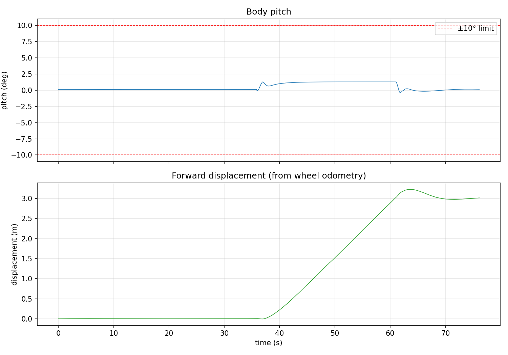

# wheel_leg_controller
## 1.内容

这次的作业是要把主程序的读取模拟器参数，计算力矩并输入仿真软件，推动模拟器运行并得到下一组参数拆分成mujoco仿真软件（负责进行模拟和输出状态）和wheel_leg_controller（负责接收状态，换算参数并输出力矩给仿真软件）两个部分。

## 2.系统架构

```
              /cmd_vel (geometry_msgs/Twist，外部给定)
                   │
                   ▼
wheel_leg_sim ──/imu──────────────▶ wheel_leg_controller
 (MuJoCo 仿真) ──/joint_states────▶  (LQR + VMC 控制)
              ◀──/actuator_cmd─────┘
                 (rm_msgs/WheelLegCmd，6 个力矩)
```
仿真节点负责模拟轮腿机器人状态和输出每一时刻的参数，控制器负责根据状态计算力矩输入回仿真软件，实现仿真软件中轮腿机器人的平衡与行动

## 3.如何实现
回调函数负责存储数据，不做任何计算，而计时器负责计算与输出。这样做是为了保证算法固定的计算周期。
build_info()负责将订阅到的消息拼成一个完整且格式与算法函数相同的字典，方便计算，因此算法代码可以照搬
原来的while循环被计时器和回调函数替代，用于进行和仿真节点对应的输入输出

K的来源：为了计算LQR的增益，通过计算12个不同的腿长的K值，再通过一个三次方程拟合求出四个系数，最终得到范围内任意腿长的K

PID，速度滤波器，roll平衡器的参数沿用robot_control_main.py原版

## 4.运行方法

```bash
conda activate rm_ros2
cd ros2_ws
colcon build --packages-select rm_msgs wheel_leg_sim wheel_leg_controller
source install/setup.bash

# 一键启动（仿真 + 控制器 + 手柄）
ros2 launch wheel_leg_controller wheel_leg.launch.py
# 没有手柄时
ros2 launch wheel_leg_controller wheel_leg.launch.py use_joy:=false
```

也可以分终端单独启动：

```bash
# 终端 1：仿真
ros2 run wheel_leg_sim wheel_leg_sim
# 终端 2：控制器
ros2 run wheel_leg_controller wheel_leg_controller
# 终端 3：发送速度指令
ros2 topic pub --once /cmd_vel geometry_msgs/msg/Twist "{linear: {x: 0.3}}"
ros2 topic pub --once /cmd_vel geometry_msgs/msg/Twist "{}"
```
## 5.测试结果

录制命令：

```bash
ros2 bag record /imu /joint_states /actuator_cmd -o balance_test
```

测试流程：原地站立 → 转向避开前方的坡 → 以 $0.3\,\text{m/s}$ 前进 → 停止并站立。用 `plot_bag.py` 从 bag 中计算：

| 指标 | 结果 | 要求 |
|---|---|---|
| 平衡时长 | 76.1 s，全程未摔 | ≥ 5 s |
| pitch 平均值 | 0.46° | — |
| pitch 最大偏差 | **1.28°** | < 10° |
| 前进位移 | **3.01 m**（最大 3.23 m） | ≥ 3 m 不摔 |

测试方法：python3 scripts/ploy_bag.py bag/balance_test（此脚本借助ai编写）


## 6.手柄遥控

由 ROS2 官方的 `joy_node` 读取手柄并发布 `/joy`，控制器只订阅话题，不直接接触硬件。映射沿用 Xbox 360 布局：

| 操作 | 轴/键 | 效果 |
|---|---|---|
| 左摇杆 上下 | `axes[1]` | $v = \text{axis} \times 0.6\,\text{m/s}$ |
| 右摇杆 左右 | `axes[3]` | $\omega = -\text{axis} \times 2.0\,\text{rad/s}$ |
| RB / LB | `buttons[5]` / `buttons[4]` | 目标腿长 ±0.005 m，限位 0.10–0.14 m |
通过测试发现手柄的前进摇杆对应仿真机器人的后退，于是在对应算法中删去了负号
由于测试者的手柄非xbox手柄，因此无法测试转向系统

## 7.任务分析
经常出现对应字符拼写错误(jiont_states拼写错误编译器不报错，但收不到数据)，下次应多使用tab键纠错
在多次测试的时候未配置bashrc，导致重复测试耗时过长，下次应先配置测试环境

